<div align="center">

<a href="https://kncn23.github.io"></a>

# kncn23.github.io

**Personal portfolio of [Ata Kaan Can Olcay](https://github.com/KNCn23)** — Computer Engineering @ Başkent University
Embedded systems · Edge AI · Systems programming · Optimization

[](https://kncn23.github.io)
[](https://github.com/KNCn23/KNCn23.github.io/deployments)
[](#-structure)
[](#-motion)

**[Visit the site →](https://kncn23.github.io)**

</div>

---

## ✨ Highlights

- 🌐 **Bilingual (EN / TR)** — language switcher with browser-language auto-detection, choice persisted in `localStorage`
- 🎨 **Hand-crafted cinematic dark design** — light ribbons drawn on a canvas behind the hero, glass panels and one acid-lime signal colour; pure HTML/CSS/JS, no frameworks, no build step
- ⭐ **Live GitHub data** — star counts and repo stats fetched from the GitHub API at runtime; degrades gracefully when offline or rate-limited
- 🗂️ **Filterable project grid** — Embedded & Systems · AI & ML · Security & Crypto · Optimization · Web & Backend · Games
- 🧵 **Scroll spine & rail** — animated SVG path that follows your reading progress through the page
- 🎞️ **Motion layer** — boot sequence, light ribbons that follow the reader, Lenis smooth scrolling and GSAP choreography (see [Motion](#-motion)); project diagrams run while on screen (a TCP handshake, an RTOS scheduler, the INT8 pipeline). All of it switches off under `prefers-reduced-motion`, and the page renders complete without it
- 🔍 **SEO-ready** — sitemap, robots.txt, Open Graph card, semantic markup

## 🎨 Design language

The whole site runs on a small set of CSS custom properties.

A green-tinted near-black ground, luminous ribbons behind the hero (Canvas 2D,
additive blending, paused off-screen), glass panels with hairline borders, and a
single acid-lime signal colour for anything live, selected or clickable.
Headlines set in a geometric sans carry one italic-serif accent word.

| | Token | Hex | Role |
|---|---|---|---|
|  | `--bg` | `#0a0c09` | Page ground |
|  | `--bg-2` | `#12150f` | Raised surfaces |
|  | `--text` | `#e9ecdf` | Headings & primary text |
|  | `--body` | `#b3b9a7` | Body text |
|  | `--muted` | `#7c8474` | Labels & secondary text |
|  | `--lime` | `#c8f135` | Signal colour |
|  | `--mint` | `#8fe0b2` | Secondary accent |

Glass surfaces and hairlines are white at low alpha (`--glass` 3.5 %, `--line` 8 %, `--line-2` 14 %).

**Typography:** [Geist](https://fonts.google.com/specimen/Geist) for headlines and body · [Instrument Serif](https://fonts.google.com/specimen/Instrument+Serif) italic for accent words · [Geist Mono](https://fonts.google.com/specimen/Geist+Mono) for labels, codes and parameters

## 🗂️ Structure

```
.
├── index.html             # single-page layout — all sections
├── assets/
│   ├── style.css          # design tokens + all styles
│   ├── script.js          # i18n dictionary, project data, filters, GitHub API, scroll spine
│   ├── motion.js          # boot sequence, light ribbons, count-ups, live diagrams, CSS-path fallbacks
│   ├── fx.js              # GSAP + Lenis layer: intro, scroll reveals, parallax, React Bits ports
│   ├── og-image.png       # social preview card
│   └── cv/                # downloadable CV (PDF)
├── robots.txt
└── sitemap.xml
```

Everything is data-driven from [`assets/script.js`](assets/script.js): the `I18N` dictionary holds every string in both languages, and `FEATURED` / `PROJECTS` arrays feed the project cards — adding a project is a single array entry.

## 🎞️ Motion

[GSAP 3.15](https://gsap.com) (ScrollTrigger, SplitText, ScrambleText) and [Lenis 1.3](https://github.com/darkroomengineering/lenis) load from jsDelivr with pinned versions and SRI hashes. [`assets/fx.js`](assets/fx.js) drives:

- **Lenis** smooth scrolling on GSAP's ticker, feeding ScrollTrigger; anchors respect the nav's `scroll-padding-top`
- **SplitText** headlines — words rise out of masks; **ScrambleText** decodes the section numbers
- **ScrollTrigger** — blur-in batch reveals, a scrubbed hero exit parallax, a scrubbed progress line through the experience timeline, and a nav that hides on the way down
- Ports of [React Bits](https://reactbits.dev) effects to vanilla JS: **Magnet** buttons, a **TiltedCard** hero panel with glare, a **ScrollVelocity** band of the stack, and **ShinyText** on the hero pill — © David Haz, MIT + Commons Clause

`motion.js` only switches the layer on when motion is allowed and the libraries actually loaded. If the CDN is unreachable, the original CSS/IntersectionObserver reveals take over.

## 🚀 Running locally

No build step — clone and serve:

```bash
git clone https://github.com/KNCn23/KNCn23.github.io.git
cd KNCn23.github.io
python3 -m http.server 8000   # → http://localhost:8000
```

…or just open `index.html` in a browser.

## 📬 Contact

<div align="center">

[**GitHub**](https://github.com/KNCn23) · [**LinkedIn**](https://www.linkedin.com/in/ata-kaan-can-olcay-0154a2208/) · [**CV**](assets/cv/Ata-Kaan-Can-Olcay-CV.pdf)

<sub>Built with plain HTML, CSS and JS — no frameworks and no build step, just GSAP and Lenis from a CDN.</sub>

</div>
